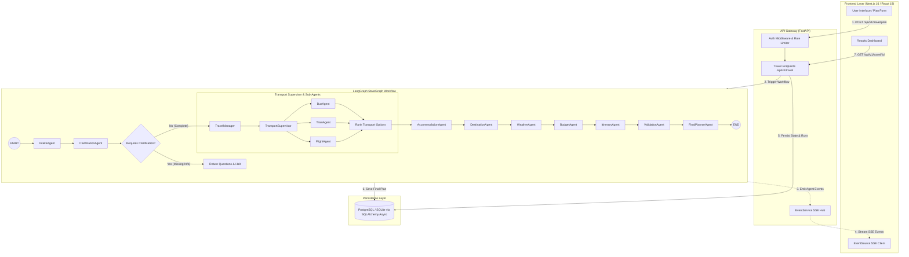

# Multi-Agent AI Travel Planner

[](https://fastapi.tiangolo.com)
[](https://nextjs.org)
[](https://github.com/langchain-ai/langgraph)
[](https://groq.com)
[](LICENSE)

An end-to-end, multi-agent travel planning platform that transforms natural-language travel prompts into structured, cost-optimized, and mathematically verified itineraries. Coordinated by a central **LangGraph StateGraph**, 14 specialized AI agents handle distinct travel domains - from multi-modal transit comparison and lodging selection to budget audits and real-time execution streaming.

---

## Table of Contents
- [Project Overview](#project-overview)
- [Live Demo and Screenshots](#live-demo-and-screenshots)
- [Features](#features)
- [Tech Stack](#tech-stack)
- [System Architecture](#system-architecture)
- [AI Agents and Workflow](#ai-agents-and-workflow)
- [Project Structure](#project-structure)
- [Installation and Setup](#installation-and-setup)
- [API Overview](#api-overview)
- [Limitations and Future Improvements](#limitations-and-future-improvements)

---

## Project Overview

Planning an end-to-end trip involves balancing numerous interdependent constraints: multi-modal transit schedules (buses, trains, flights), accommodation proximity, local attractions, seasonal weather advisories, and strict budget caps. 

Standard single-prompt LLM chatbots face severe limitations in travel planning:
- **Context Drift & Hallucination**: Monolithic prompts lose track of detailed constraints and invent non-existent travel connections or schedules.
- **Arithmetic Errors**: LLMs struggle with deterministic financial arithmetic, leading to inaccurate budget subtotals.
- **Lack of Verification**: Chatbot outputs lack programmatic validation against calendar dates, transit buffers, and budget ceilings.

### The Multi-Agent Solution
This project solves these challenges by decomposing the travel planning pipeline into **14 domain-specific AI agents** orchestrated via **LangGraph**:
1. **Separation of Concerns**: Each agent operates on an isolated domain (e.g., transit evaluation, lodging, budget calculation, weather analysis) with dedicated context and tools.
2. **Hybrid Architecture (LLM Synthesis + Deterministic Tools)**: Creative tasks (recommendations, summaries) are handled by LLMs, while quantitative operations (budget subtotals, route scoring, validation audits) are executed by deterministic Python logic.
3. **Formal Verification**: A dedicated `ValidationAgent` programmatically audits itineraries against travel times, budget ceilings, and logistical conflicts before finalizing the plan.
4. **Live Observability**: Life-cycle execution events are streamed to the client in real time via Server-Sent Events (SSE).

---

## Live Demo and Screenshots

- **Live Application (Frontend)**: [https://multi-agent-traveler-plan.vercel.app/](https://multi-agent-traveler-plan.vercel.app/)
- **Backend API**: [https://travel-planner-api-38r5.onrender.com](https://travel-planner-api-38r5.onrender.com/)
- **Interactive API Documentation (Swagger UI)**: [https://travel-planner-api-38r5.onrender.com/docs](https://travel-planner-api-38r5.onrender.com/docs)
- **Alternative API Documentation (ReDoc)**: [https://travel-planner-api-38r5.onrender.com/redoc](https://travel-planner-api-38r5.onrender.com/redoc)

> **Screenshots**: No static screenshot assets are currently stored in this repository. Please visit the live deployment link above to experience the interactive UI, real-time agent execution timeline, and plan visualization.

---

## Features

- **Natural Language Trip Intake**: Parses unstructured prompts (e.g., *"Plan a 4-day budget trip from Hyderabad to Goa for 2 friends under INR 30,000"*) into structured entities including origin, destination, dates, budget, travelers, and travel style.
- **Interactive Clarification Dialog**: Analyzes user constraints for ambiguities (e.g., missing departure city, unspecified dates). Pauses execution and asks targeted clarification questions before initiating expensive workflows.
- **14 Specialized Collaborative Agents**: Orchestrated in sequential and parallel stages via a typed LangGraph `StateGraph`.
- **Multi-Modal Transport Evaluation**: Queries and compares buses, trains, and flights across duration, price, and convenience scores tailored to user preferences (`rank_transport_options`).
- **Real-Time Agent Execution Progress (SSE)**: Streams live lifecycle events (`started`, `completed`, `error`) from the planning service to the frontend using HTML5 Server-Sent Events.
- **Deterministic Budget & Validation Engine**: Computes exact subtotal breakdowns (transportation, lodging, food, activities) and programmatically flags deficit risks and timing collisions.
- **User Authentication & Data Isolation**: Secure registration and login powered by bcrypt password hashing, PyJWT tokens, HTTP-only session cookies, and IDOR protection.
- **Safety & Cost Guardrails**: Enforces sliding-window rate limits, concurrent workflow semaphores (`MAX_CONCURRENT_PLANS_TOTAL`), and daily/monthly LLM budget ceilings (`DAILY_LLM_BUDGET_USD`).
- **Plan History & Conversational Replanning**: Allows authenticated users to view saved itineraries and submit modifications via natural-language replanning prompts.

---

## Tech Stack

### Backend
- **Language**: Python 3.11+
- **Web Framework**: FastAPI (Async REST API, OpenAPI/Swagger docs)
- **Agent Orchestration**: LangGraph (`StateGraph`) & LangChain
- **LLM Provider**: Groq (`openai/gpt-oss-120b`, `llama-3.3-70b-versatile` via OpenAI-compatible API) with extensible support for OpenAI (`gpt-4o-mini`) and Google Gemini (`gemini-1.5-pro`)
- **Database & ORM**: PostgreSQL (Production) / SQLite (Local Development) via SQLAlchemy 2.0 (AsyncIO)
- **Schema Migrations**: Alembic
- **Validation**: Pydantic v2 & Pydantic-Settings
- **Real-Time Streaming**: `sse-starlette` (Server-Sent Events)
- **Security & Cryptography**: PyJWT (JWT tokens) & bcrypt (password hashing)
- **Logging**: Structlog (Structured JSON logs in production)

### Frontend
- **Framework**: Next.js 16 (App Router) & React 19
- **Language**: TypeScript
- **Styling**: Tailwind CSS v4
- **State & Data Fetching**: TanStack React Query v5 & Zod (form schema validation)
- **Streaming Client**: HTML5 `EventSource` (SSE)

### Infrastructure & Deployment
- **Frontend Hosting**: Vercel
- **Backend Hosting**: Render (FastAPI Web Service with `render.yaml` Blueprint)
- **Production Database**: External PostgreSQL (Supabase / Render)
- **Containerization**: Docker & Docker Compose

---

## System Architecture

The following Mermaid diagram illustrates the end-to-end request flow, client-server communication, database persistence, and LangGraph multi-agent orchestration:



---

## AI Agents and Workflow

The system employs **14 specialized agents** that operate cooperatively on a shared, typed `TravelState`. Each agent fulfills a dedicated role defined in `backend/app/agents/`:

| # | Agent Name | Source File | Core Role & Responsibilities |
|---|---|---|---|
| 1 | **IntakeAgent** | `app/agents/intake.py` | Parses free-text prompts into structured parameters: origin, destination, dates, traveler count, budget, and travel style. |
| 2 | **ClarificationAgent** | `app/agents/clarification.py` | Detects missing or conflicting constraints (e.g., unspecified departure dates or missing budget) and formulates clarifying questions. |
| 3 | **TravelManager** | `app/agents/manager.py` | Coordinates overall execution strategy, establishes target segment milestones, and sets budget allocation boundaries. |
| 4 | **TransportSupervisor** | `app/agents/transport_supervisor.py` | Dispatches modal sub-agents (Bus, Train, Flight), normalizes travel options, and executes deterministic ranking via `rank_transport_options`. |
| 5 | **BusAgent** | `app/agents/bus.py` | Queries bus providers for intercity routes, seat/sleeper categories, operators, durations, and pricing. |
| 6 | **TrainAgent** | `app/agents/train.py` | Evaluates railway itineraries, train classes (e.g., 1A, 2A, 3A, SL), timetables, and ticket availability. |
| 7 | **FlightAgent** | `app/agents/flight.py` | Evaluates air travel options, airlines, nonstop/connecting flights, baggage limits, and airfares. |
| 8 | **AccommodationAgent** | `app/agents/accommodation.py` | Discovers verified lodging (hotels, hostels, resorts) matching budget tier, traveler count, ratings, and location proximity. |
| 9 | **DestinationAgent** | `app/agents/destination.py` | Recommends curated attractions, cultural landmarks, and activities tailored to user travel style with operating hours and fees. |
| 10 | **WeatherAgent** | `app/agents/weather.py` | Analyzes forecast and seasonal climate patterns for the destination; flags weather risks (rain, extreme heat) and recommends packing gear. |
| 11 | **BudgetAgent** | `app/agents/budget.py` | Computes itemized financial subtotals (transport, lodging, activities, food) with deterministic math and verifies adherence to total budget limits. |
| 12 | **ItineraryAgent** | `app/agents/itinerary.py` | Synthesizes a day-by-day chronological itinerary with time-slotted activities, transit buffers, and rest blocks. |
| 13 | **ValidationAgent** | `app/agents/validation.py` | Programmatically audits the draft itinerary for temporal conflicts, geographic feasibility, and budget compliance. |
| 14 | **FinalPlannerAgent** | `app/agents/final_planner.py` | Synthesizes the executive trip brief, daily schedule, budget summary, emergency tips, and finalized JSON payload. |

### Data Providers: Realistic Mocks vs. Live Integration

> **Transparency Note**: To make this project freely cloneable, runnable, and testable without requiring paid enterprise travel API contracts (such as Amadeus, Sabre, IRCTC, or Skyscanner GDS agreements), the project includes pre-seeded **Mock Data Providers**.

- **Mock Providers**: Included for Indian travel corridors (e.g., Hyderabad <-> Goa, Delhi <-> Mumbai, Bangalore <-> Goa). They simulate realistic transit schedules, hotel pricing distributions, attraction catalogs, and climate norms.
- **Provider Abstraction**: All agents interact with providers via abstract base classes (`BusProvider`, `TrainProvider`, `FlightProvider`, `AccommodationProvider`, `DestinationProvider`, `WeatherProvider`).
- **Extensibility**: Integrating a live commercial API requires only implementing the corresponding base class and configuring credentials in `.env`.

---

## Project Structure

```
ai-travel-agent/
|-- backend/
|   |-- app/
|   |   |-- agents/            # 14 specialized AI agents + context builders
|   |   |-- api/v1/            # FastAPI endpoints (auth, travel, preferences, events, health)
|   |   |-- core/              # Config, security (JWT/bcrypt), rate limiting, logging
|   |   |-- db/                # SQLAlchemy async session, base models, repositories
|   |   |-- graph/             # LangGraph StateGraph workflow and state definitions
|   |   |-- models/            # SQLAlchemy database entities (User, TravelRun, etc.)
|   |   |-- providers/         # LLM (Groq/OpenAI/Gemini) & domain provider interfaces (Mock)
|   |   |-- schemas/           # Pydantic v2 validation models
|   |   |-- services/          # Planning service, event hub, transport ranker
|   |   \-- tools/             # Deterministic tools (budget, maps, transport, weather)
|   |-- migrations/            # Alembic database migrations
|   |-- tests/                 # 47 unit & integration tests (auth, db, agents, tools)
|   |-- pyproject.toml         # Python package metadata and dependencies
|   |-- requirements.txt       # Production pinned backend requirements
|   \-- Dockerfile             # Backend container image definition
|-- frontend/
|   |-- src/
|   |   |-- app/               # Next.js 16 App Router pages (login, plan, preferences, results)
|   |   |-- components/        # React components (PlanForm, AgentProgress, ResultsDashboard)
|   |   |-- context/           # AuthContext for authentication state
|   |   |-- hooks/             # Custom hooks (useTravelPlan, usePlanningEvents, usePreferences)
|   |   |-- lib/               # API client, SSE subscriber, utility functions
|   |   |-- schemas/           # Zod form validation schemas
|   |   \-- types/             # TypeScript domain definitions
|   |-- package.json           # Frontend package configuration (Next.js 16, React 19)
|   \-- Dockerfile             # Frontend container image definition
|-- docs/                      # Technical documentation (architecture, deployment, security)
|-- docker-compose.yml         # Multi-container orchestration (Backend, Frontend, PostgreSQL)
|-- render.yaml                # Infrastructure-as-Code blueprint for Render deployment
\-- README.md                  # Project documentation
```

---

## Installation and Setup

### Prerequisites
- **Python**: 3.11 or higher
- **Node.js**: 20.x or higher
- **Git**
- **Groq API Key**: Free tier key from [console.groq.com](https://console.groq.com)

---

### 1. Backend Setup

```bash
# Navigate to backend directory
cd backend

# Create and activate a Python virtual environment
# On Windows (PowerShell):
python -m venv .venv
.venv\Scripts\activate

# On Linux / macOS:
python3 -m venv .venv
source .venv/bin/activate

# Install dependencies (including development and test packages)
pip install -e ".[dev]"
# Or install directly via requirements.txt:
# pip install -r requirements.txt

# Configure environment variables
cp .env.example .env
```

Open `backend/.env` and configure your credentials:
```env
APP_ENV=development
DATABASE_URL=sqlite+aiosqlite:///./travel_planner.db
JWT_SECRET_KEY=dev-insecure-secret-key-change-in-production-min32chars
LLM_PROVIDER=groq
LLM_MODEL=openai/gpt-oss-120b
LLM_BASE_URL=https://api.groq.com/openai/v1
LLM_API_KEY=gsk_your_actual_groq_api_key_here
```

Run database migrations and start the backend:
```bash
# Apply Alembic database migrations
alembic upgrade head

# Start FastAPI development server
uvicorn app.main:app --reload --host 0.0.0.0 --port 8000
```
Backend API will be running at `http://localhost:8000`. Interactive documentation is available at `http://localhost:8000/docs`.

---

### 2. Frontend Setup

In a new terminal window:
```bash
# Navigate to frontend directory
cd frontend

# Install dependencies
npm install

# Configure environment variables
cp .env.example .env.local
```

Ensure `frontend/.env.local` points to your backend instance:
```env
NEXT_PUBLIC_API_URL=http://localhost:8000
```

Start the Next.js development server:
```bash
npm run dev
```
Open your browser to `http://localhost:3000`.

---

### 3. Docker Compose (Optional)

To spin up the complete stack (PostgreSQL, FastAPI backend, and Next.js frontend) with Docker:

```bash
# Build and launch all services
docker compose up -d --build

# Inspect service logs
docker compose logs -f

# Shut down services
docker compose down
```

---

### 4. Running Tests

The test suite validates authentication, security policies, database configuration, LangGraph workflow execution, and deterministic tools:

```bash
# Run backend pytest suite (47 tests)
cd backend
python -m pytest tests/ -v

# Run frontend build check
cd ../frontend
npm run build
```

---

## API Overview

The FastAPI backend exposes RESTful endpoints with OpenAPI schema definitions.

| Method | Endpoint | Description | Auth Required |
|---|---|---|:---:|
| `POST` | `/api/v1/register` | Register a new user account | No |
| `POST` | `/api/v1/login` | Authenticate user and receive JWT token / HTTP-only cookie | No |
| `GET` | `/api/v1/me` | Retrieve profile of currently authenticated user | Yes |
| `POST` | `/api/v1/logout` | Clear user authentication session cookie | No |
| `GET` | `/api/v1/health` | Service liveness probe, environment mode, and provider status | No |
| `GET` | `/api/v1/ready` | Readiness probe verifying database connectivity | No |
| `POST` | `/api/v1/travel/plan` | Initialize a multi-agent travel planning run | Yes |
| `POST` | `/api/v1/travel/clarify` | Submit answers to agent clarification questions | Yes |
| `GET` | `/api/v1/travel/history` | List travel planning runs created by the user | Yes |
| `GET` | `/api/v1/travel/{request_id}` | Retrieve status and generated plan payload for a run | Yes |
| `POST` | `/api/v1/travel/{request_id}/replan` | Request conversational modifications to an existing plan | Yes |
| `GET` | `/api/v1/travel/{request_id}/events` | Connect to live Server-Sent Events (SSE) agent timeline | Yes |
| `GET` | `/api/v1/preferences` | Retrieve user-saved travel style and budget preferences | Yes |
| `PUT` | `/api/v1/preferences` | Update user travel style and budget preferences | Yes |

- **Live Interactive Docs**: [https://travel-planner-api-38r5.onrender.com/docs](https://travel-planner-api-38r5.onrender.com/docs)
- **Local Interactive Docs**: `http://localhost:8000/docs`

---

## Limitations and Future Improvements

### Current Limitations
- **Simulated Provider Data**: Transit schedules, lodging listings, attractions, and weather forecasts utilize simulated mock datasets rather than live commercial booking engines.
- **No Transactional Checkout**: Seat reservations, hotel bookings, and payment gateway transactions are not implemented.
- **Geographic Coverage**: Pre-seeded mock travel data focuses primarily on major Indian travel corridors.

### Planned Enhancements
- **Live GDS & Travel API Adapters**: Implement production provider classes for commercial APIs (e.g., Amadeus, Skyscanner, IRCTC, Booking.com, OpenWeather).
- **Interactive Route Mapping**: Integrate Mapbox / Leaflet for dynamic geographic visualization of transit paths and daily attraction clusters.
- **Export Capabilities**: Add one-click export of finalized itineraries to Google Calendar, iCalendar (.ics), and formatted PDF documents.
- **Collaborative Group Planning**: Support multi-user collaborative planning rooms using WebSockets.

---

## License

This project is licensed under the MIT License - see the [LICENSE](LICENSE) file for details.
